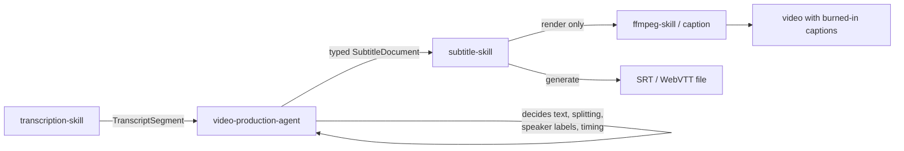
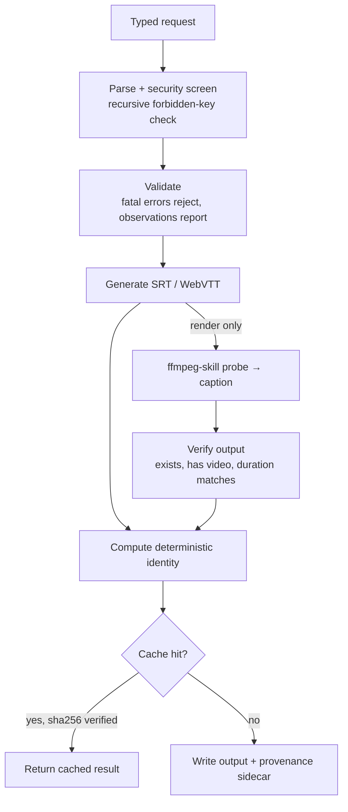

<p align="center">
  <picture>
    <source media="(prefers-color-scheme: dark)" srcset="brand/app-icon-dark.png">
    
  </picture>
</p>

<p align="center">
  <picture>
    <source media="(prefers-color-scheme: dark)" srcset="brand/logo/subtitle-skill-wordmark-white.svg">
    
  </picture>
</p>

<p align="center"><b>Words make video reach further — deterministically.</b><br>
Typed subtitle documents · Local execution · No AI reasoning · No cloud<br>
Part of the same execution-skill ecosystem as <a href="https://github.com/kajisho5/ffmpeg-skill">ffmpeg-skill</a></p>

<p align="center">
  <a href="#quick-start"><b>Quick start</b></a> ·
  <a href="#how-it-works">How it works</a> ·
  <a href="#built-for-agents">Built for agents</a> ·
  <a href="#ffmpeg-skill-integration">ffmpeg-skill integration</a> ·
  <a href="SKILL.md">SKILL.md</a>
</p>

<p align="center">
  <a href="https://github.com/kajisho5/subtitle-skill/actions/workflows/ci.yml"></a>
  
  <a href="LICENSE"></a>
</p>

```bash
pip install -e .
```

`subtitle-skill` is not "AI that writes captions." It is the execution
layer that turns a subtitle *decision* — already made by an upstream
agent — into a real artifact: validated, deterministic, verified, and
traceable. It never decides what a caption should say; it decides
whether the timeline is valid, generates SRT/WebVTT, and — by
delegating to [ffmpeg-skill](https://github.com/kajisho5/ffmpeg-skill)'s
`caption` tool — burns it into a video, then checks that the result is
actually correct.

If a typed `SubtitleDocument` and (for burn-in) an ffmpeg-skill install
are on hand, it works: no network access, no API keys, nothing decided
that wasn't handed to it. Machine translation (`translate`) follows the
same rule by default: the offline Argos Translate engine or a
caller-supplied translation memory; offline OPUS-MT (CTranslate2) and a
local Ollama LLM are opt-in engines, and the DeepL API is an opt-in engine
that needs a key in the environment
([ADR-004](docs/adr/ADR-004-translation-engine.md)).

---

**Contents**
[Why](#why) · [Quick start](#quick-start) · [How it works](#how-it-works) · [Design principles](#design-principles) · [Operations](#operations) · [Format support](#format-support) · [Validation is not cosmetic](#validation-is-not-cosmetic) · [Built for agents](#built-for-agents) · [ffmpeg-skill integration](#ffmpeg-skill-integration) · [Verified](#verified) · [Install](#install) · [Development](#development) · [Docs](#docs) · [Support](#support)

---

## Why

An agent that "handles captions" tends to guess: it burns a subtitle
past the end of the video and calls it done, it forgets that a WebVTT
file can't be burned in by the tool underneath it, or it reports success
because a process exited `0` without checking what actually got
written. subtitle-skill exists to take the guessing out of the
*execution* half of captioning:

- **Typed input, not a dict.** A subtitle is a `SubtitleDocument` of
  `SubtitleCue`s — parsed and validated once, never touched as raw JSON
  again.
- **Fatal vs. observation, never confused.** A broken timeline is
  rejected before anything is written. A borderline one (overlapping
  cues, a line that's too long) is reported, never silently "fixed" —
  no cue is ever deleted, reordered, merged, or shifted.
- **Verification after execution.** A render is only "done" when the
  output file exists, has a video stream, and its duration matches the
  *actual*, measured input — not when a subprocess happens to exit `0`.
- **A contract the agent can read.** `contract --json` states exactly
  which operations, formats, parameters and error codes this version
  supports. `doctor --json` states what can *actually* run right now.
- **No decisions made here.** What the text says, how it's split, which
  speaker to show — that's `video-production-agent`'s job. subtitle-skill
  only ever receives the result, as a typed request.

## Quick start

```bash
pip install -e .
subtitle-skill doctor --json     # what can actually run on this machine
subtitle-skill contract --json   # operations, formats, parameters, errors
```

Generate an SRT file from a typed subtitle document — no video needed:

```bash
cat > request.json <<'EOF'
{
  "operation": "generate",
  "workspace": "/tmp/subtitles-demo",
  "format": "srt",
  "output_path": "captions.srt",
  "subtitle": {
    "id": "doc-1",
    "language": "en",
    "cues": [
      {"id": "c1", "start": 0.0, "end": 2.5, "text": "Hello and welcome"},
      {"id": "c2", "start": 2.5, "end": 5.0, "text": "to the show.", "speaker": "Host"}
    ]
  }
}
EOF
subtitle-skill run request.json --json
```

```json
{"status": "ok", "operation": "generate", "output": ".../captions.srt",
 "sha256": "4ffe0640...", "size": 103, "reused": false,
 "observation": [], "timeline": {"cue_count": 2}, ...}
```

Burning that same subtitle into a video — `"operation": "render"` —
needs `format: "srt"` and a reachable ffmpeg-skill install (see
[ffmpeg-skill integration](#ffmpeg-skill-integration)); the request
shape is identical otherwise, just add `video_input`. Add
`"mode": "mux"` instead of the default `"burn"` for a soft, toggleable
subtitle track rather than pixels burned into the picture, and
`"audio_stream": 1` (0-based) to pick a non-default audio track on a
multi-track input — see [Operations](#operations).

## How it works



subtitle-skill sits at the bottom of that chain, as a *leaf* execution
skill: it receives an already-decided, typed request and executes it
mechanically. Internally:



## Design principles

These are the rules the code enforces — not aspirations.

1. **Typed, not stringly.** Every subtitle is a `SubtitleDocument` /
   `SubtitleCue` / `SubtitleStyle` — parsed through `from_dict` once;
   nothing downstream touches a raw dict.
2. **Fatal and observation are never the same code path.** `start < 0`,
   `end <= start`, NaN/Infinity, duplicate ids, empty/invalid text, and a
   cue past the video's real duration reject the request outright.
   Overlaps, long lines, short/long cues, and reading speed are reported
   in `observation` and never auto-corrected.
3. **The request's `video_duration` is a hint, not a fact.** For
   `render`, the document is re-validated against ffmpeg-skill's own
   measured duration of the actual video — an omitted or wrong hint
   can't let a cue past the real end of the video through silently.
4. **No shell, no arbitrary executable, no arbitrary filter.** Every
   subprocess call is a fixed argv list. `command`, `argv`, `shell`,
   `executable`, `filter`, `filter_complex`, `vf`, `af`, `env`, `api_key`
   are rejected anywhere in the request, at any nesting depth.
5. **Workspace-confined paths.** Absolute paths, drive-qualified paths,
   `..`, and Windows reserved device names are rejected; a resolved
   (symlink-following) path must still land inside the workspace root.
6. **Exit code `0` is never sufficient.** A render is accepted only when
   ffmpeg-skill reports `"status": "completed"`, the output file exists
   and is non-empty, it has a video stream, and its duration matches the
   input within 0.25s.
7. **Deterministic identity, content-addressed.** Same document, format,
   constraints (and for `render`, the same video and the same
   ffmpeg-skill script content) → same identity → a verified cache hit,
   not a re-render. A corrupted or hash-mismatched cache is never
   returned as reused.
8. **Machine-readable contract.** `contract --json` is generated from
   what's actually implemented — an operation or format that isn't
   executable doesn't appear as supported.

## Operations

Four operations exist. All appear in `contract --json`; nothing else
does — `convert`, `offset`, `merge`, and ASS/SSA are not implemented and
cannot be called.

| Operation | Video I/O | Formats | What it does |
|---|---|---|---|
| `generate` | none | SRT, WebVTT | Validate the document, write a subtitle file |
| `render` | required | **SRT only** | Validate against the real video duration, generate the SRT, delegate burn-in (or mux) to ffmpeg-skill's `caption` tool, verify the output |
| `translate` | none | SRT, WebVTT | Machine-translate a document into `target_language`: same cue ids and timecodes, text re-broken and re-validated for the target language, glossary checked ([ADR-004](docs/adr/ADR-004-translation-engine.md)) |
| `mux` | required | **SRT only** | Several documents (one per language) → one video with language-tagged soft subtitle tracks, in one ffmpeg-skill `caption --mode mux` call ([ADR-005](docs/adr/ADR-005-multi-language-mux.md)) |

`render`'s `mode` (default `"burn"`, or `"mux"`) and `audio_stream`
(0-based, optional) map directly onto ffmpeg-skill `caption.py`'s own
`--mode`/`--audio-stream` flags — see
[ffmpeg-skill integration](#ffmpeg-skill-integration) for exactly what
each does and `subtitle.language`'s forwarding as the mux language tag.

### `translate`

```json
{
  "operation": "translate",
  "workspace": "/absolute/path/to/workspace",
  "subtitle": {"id": "ep01", "language": "ja", "cues": [{"id": "1", "start": 0.5, "end": 3.0, "text": "今日は字幕の\n翻訳を試します。"}]},
  "target_language": "en",
  "format": "srt",
  "output_path": "ep01.en.srt",
  "engine": "argos | opus-mt | ollama | deepl | memory",
  "glossary": [{"source": "字幕", "target": "subtitles"}],
  "translation_memory": [{"source": "今日は字幕の翻訳を試します。", "target": "Today we will try translating subtitles."}],
  "constraints": {"max_chars_per_line": 42}
}
```

| `engine` | Needs | Network | Glossary |
|---|---|---|---|
| `argos` (default) | `pip install argostranslate` and an **already installed** language package (`argospm install translate-ja_en`). subtitle-skill never downloads a model, and refuses Argos when it is set to a remote provider | never | each source term is replaced by its target term before translating |
| `opus-mt` | `pip install ctranslate2 sentencepiece`, and an OPUS-MT model **you converted yourself** (`ct2-transformers-converter --model Helsinki-NLP/opus-mt-ja-en --output_dir <dir>/opus-mt-ja-en --copy_files source.spm target.spm`) with `SUBTITLE_SKILL_OPUS_MT_DIR=<dir>`. Weights Apache-2.0. ja→en only in practice (no general en→ja OPUS-MT model) | never | each source term is replaced by its target term before translating |
| `ollama` | A running [Ollama](https://github.com/ollama/ollama) with the model **already pulled** (`ollama pull qwen3:8b`; `SUBTITLE_SKILL_OLLAMA_MODEL` picks another, `SUBTITLE_SKILL_OLLAMA_URL` another server — plain `http://` only to localhost). One request per cue, temperature 0. subtitle-skill never pulls a model | local only, unless you point it at an `https://` server | each source term is replaced by its target term before translating |
| `deepl` | `DEEPL_AUTH_KEY` in the environment (never in the request: `api_key` is a forbidden field). A key ending in `:fx` uses `api-free.deepl.com`; `SUBTITLE_SKILL_DEEPL_API_URL` overrides the URL | yes | a native DeepL glossary, created for the call and deleted after |
| `memory` | `translation_memory`: exact source → target pairs (whitespace-insensitive) from a human, an earlier job or an agent's own translation | never | the stored targets are used as given |

- **Timecodes are kept.** `id`, `start`, `end`, `speaker` and `style` are copied; each cue's lines are joined and translated as one segment, so timing is never stretched, merged or split.
- **Constraints apply again in the target language.** The translation is re-broken with the target's locale profile (ja/zh/ko: full-width counting and kinsoku) or wrapped at spaces, preferring a natural break (after punctuation; in Japanese after a particle) and then the shortest longer line. The translated document is then validated with the target's line length and reading speed; what still does not fit is an observation, never a rewrite.
- **Glossary terms are checked** in every engine's output: a missing target term is a `GLOSSARY_TERM_MISSING` observation.
- The response's `subtitle` is the translated document (each cue's `metadata.translation.source_text` keeps the original); `engine` / `engine_version` (Argos and model package version, CTranslate2 version and the OPUS-MT model's sha256, the Ollama version and model digest, `deepl-api v2`, or the memory's hash) are recorded in the sidecar and in `subtitle.metadata.translation`, and are part of the reuse identity, so a repeated request is never translated (or billed) twice.
- `doctor --json` lists which engines can run here under `translation_engines`, with each engine's `weights_licence`. **Commercial work: the licence of the Argos ja→en weights is not stated anywhere** — not in the index, the package's `metadata.json` or its README (checked 2026-10-31) — so use `engine: "opus-mt"` (Apache-2.0 weights) for ja→en, or `ollama` with an Apache-2.0 model such as Qwen3. `argos` stays the default so an omitted `engine` keeps its meaning. No engine's Japanese quality is measured here ([ADR-004](docs/adr/ADR-004-translation-engine.md), addendum).

### `mux`

```json
{
  "operation": "mux",
  "workspace": "/absolute/path/to/workspace",
  "video_input": "ep01.mp4",
  "output_path": "ep01.subs.mkv",
  "tracks": [
    {"subtitle": {"id": "ep01", "language": "ja", "cues": [...]}, "title": "日本語"},
    {"subtitle": {"id": "ep01.en", "language": "en", "cues": [...]}, "title": "English"}
  ],
  "default_language": "en",
  "audio_stream": 0
}
```

- One `caption.py --mode mux` call with `--srt FILE:LANG` per track (ffmpeg-skill 1.16+ for more than one track, titles or a default track). Video and audio are copied untouched.
- The subtitle codec follows the container: `mov_text` in `.mp4`/`.m4v`/`.mov`, SubRip in `.mkv`, WebVTT in `.webm`. MPEG-4 stores ISO 639-2 language codes, so ffmpeg-skill writes `ja` as `jpn` and `en` as `eng` (reported as `tracks[].stored_language`); Matroska keeps the tag as given. MPEG-4 also drops track titles and always enables its first subtitle track. `.mkv` is the honest multi-language container.
- Each track's language is its document's `language`; two tracks may not share one. A title goes on every track or on none.
- Every document is validated against ffmpeg-skill's probed duration (a cue past the end rejects the request, with the track's language in the cue id: `ja:2`). Timing passes through unchanged: caption.py is told not to lengthen or split cues (`--min-duration 0`, a `--max-lines` no cue reaches), which it would otherwise do to the first track only. It can still re-wrap the first track's lines for a narrow frame (it has no switch for that); when it does, the response carries a `TRACK_RELAID_OUT` observation.
- ASS tracks are not muxed: subtitle-skill generates no ASS, and caption.py refuses `--mode mux --ass`.

`contract --json` also publishes `provides`: `generate` as Capability id
`subtitle.generate`, `render` as `subtitle.render`, `translate` as
`subtitle.translate` and `mux` as `subtitle.mux` — the cross-repository
identifiers a registry (see `kajisho5/AI-video-production-OS`) can resolve
to this Skill without hardcoding it. Each entry's `tool_id` is
`subtitle/<operation>`: the short `subtitle/` prefix that
video-production-agent registers this Skill under, while `skill_id` stays
`subtitle-skill` ([ADR-002](docs/adr/ADR-002-provides-tool-id-prefix.md)).
Additive; not a behavior change to either operation.

It also publishes `dependencies`: ffmpeg-skill, as a lower bound on its
`contract_version` (`>=1.0`, the one `engine.py` was written against), not
required (only `render` and `mux` use it, through `caption` and `probe`). `version` is
read from `pyproject.toml`, the only place it is written
([ADR-003](docs/adr/ADR-003-single-source-version.md)).

```json
{
  "operation": "generate | render",
  "workspace": "/absolute/path/to/workspace",
  "format": "srt | vtt",
  "output_path": "relative/output.srt",
  "video_input": "relative/input.mp4",
  "video_duration": 123.4,
  "mode": "burn | mux",
  "audio_stream": 0,
  "subtitle": {
    "id": "doc-1", "language": "ja",
    "cues": [{"id": "c1", "start": 0.0, "end": 2.0, "text": "...", "speaker": "A", "style": {"align": "center"}}]
  },
  "constraints": {"max_chars_per_line": 42, "max_lines": 2, "min_duration": 0.5, "max_duration": 10, "reading_speed_cps": 20}
}
```

`video_input` / `video_duration` / `mode` / `audio_stream` apply to
`render` only (`mode` defaults to `"burn"`; `audio_stream` defaults to
caption.py's own default, track 0); `constraints` is optional for both
(see [Validation](#validation-is-not-cosmetic)).

## Format support

| | `generate` | `render` (burn-in) |
|---|---|---|
| SRT | ✅ | ✅ |
| WebVTT | ✅ | ❌ `UNSUPPORTED_FORMAT` |

**Generating a WebVTT file does not mean it can be burned in.** This is
a real constraint of the tool `render` delegates to — ffmpeg-skill's
`caption` burns SRT or ASS, never WebVTT — not an arbitrary restriction.
Requesting `render` with `format: "vtt"` fails immediately, before
anything is generated.

Neither generator silently drops style it can't represent — it raises
`UNSUPPORTED_FORMAT` instead:

| | SRT | WebVTT |
|---|---|---|
| `align` / `position` / `line` / `size` | rejected (no native positioning) | native cue settings |
| `bold` / `italic` | `<b>` / `<i>` tags | `<b>` / `<i>` tags |
| `color` | rejected | rejected (no safe, non-CSS-injecting form here) |
| `speaker` | `"Speaker: "` text prefix | `"Speaker: "` text prefix |

Cue/document `metadata` is auxiliary/provenance data — never written
into the rendered subtitle body of either format.

**This table describes the SRT/WebVTT text files themselves** — what a
plain subtitle file can and can't encode on its own. `render`'s actual
*burn* additionally forwards a subset of `style` to ffmpeg-skill's
`caption` tool as its own flags (a completely separate mechanism from
anything inside the SRT file) — see
[What SubtitleStyle forwards to caption.py](#what-subtitlestyle-forwards-to-captionpy)
below for exactly what.

## Validation is not cosmetic

Fatal and observation are separate systems, not a severity slider:

**Fatal** — nothing is written:
`start < 0`, `end <= start`, NaN/Infinity timestamps, duplicate cue ids,
empty/whitespace-only or invalid-Unicode/control-character text, a cue
past the video's actual duration.

**Observation** — reported, never auto-corrected:
`CUE_OVERLAP`, `TOO_MANY_LINES`, `LINE_TOO_LONG`, `CUE_TOO_SHORT`,
`CUE_TOO_LONG`, `READING_SPEED_TOO_HIGH`, and for ja/zh/ko
`KINSOKU_LINE_START`, `KINSOKU_LINE_END`.

Thresholds (`max_chars_per_line`, `max_lines`, `min_duration`,
`max_duration`, `reading_speed_cps`) are caller-supplied `constraints`,
not hard-coded domain assumptions — defaults exist only so a caller may
omit `constraints` entirely.

### Locale profiles (ja / zh / ko)

The primary subtag of `subtitle.language` selects a profile
(`src/subtitle_skill/locales.py`); every other language keeps the generic
behavior above unchanged.

| Profile | Default chars/line | Default cps | Half-width char counts as | Kinsoku classes |
|---|---|---|---|---|
| `ja` | 13 | 4 | 0.5 | W3C JLREQ (JIS X 4051) §3.1.7 / §3.1.8, strict |
| `zh` | 16 | 9 | 1 (conservative: not stated by the source) | W3C CLREQ §6.1.1 "basic" |
| `ko` | 16 | 12 | 0.5 | W3C KLREQ §7.1.2 / §7.1.3 |
| others | 42 | 20 | 1 (`len()`) | none |

- Width follows Unicode East Asian Width (UAX #11): wide, fullwidth and
  ambiguous characters count 1; narrow, halfwidth and neutral ones count
  the profile's half-width weight; combining marks count 0.
- Line-length and reading-speed defaults come from the Netflix Timed Text
  Style Guides for each language; a caller's `constraints` still win.
- Kinsoku is checked at existing line breaks (`KINSOKU_LINE_START`: a line
  begins with e.g. `。、」）ー ゃ っ ？`; `KINSOKU_LINE_END`: a line ends with
  e.g. `「『（`).
- A `LINE_TOO_LONG` / `KINSOKU_*` observation on a profiled cue can carry
  `suggested_text`, a deterministic kinsoku-compliant re-break (moving the
  break back, 追い出し) that fits `max_lines` and the line length. It is
  never applied: the cue and the output file stay exactly as sent.
- `contract --json` is unchanged by profiles (the profile is selected from
  the existing `language` field).

Every source, the exact quoted values, and the values that could not be
verified are recorded in
[docs/adr/ADR-001-locale-profiles.md](docs/adr/ADR-001-locale-profiles.md).

## Built for agents

subtitle-skill is a process boundary meant to be called by another
agent, not a general-purpose CLI tool.

```bash
subtitle-skill contract --json   # every operation, format, parameter, error this version supports
subtitle-skill doctor --json     # what can actually run right now
subtitle-skill run req.json --json   # execute one operation — always one JSON document on stdout
```

`contract --json` is generated to match what's implemented, not
maintained beside it by hand: `deterministic: true`, per-operation
`formats`, the full error-code list under `errors`, and `out_of_scope`
naming what this skill deliberately does not do. `doctor --json` reports
`render` as available only when an ffmpeg-skill install is found *and*
its own `doctor` confirms the `caption` tool's required capabilities
(`ffmpeg`, `ffprobe`, `encoder:libx264`, `encoder:aac`,
`filter:subtitles`) — subtitle-skill asks ffmpeg-skill's own detection
rather than re-implementing FFmpeg capability probing.

[`SKILL.md`](SKILL.md) is the agent-facing usage guide: when to call this
skill, how to build a `SubtitleDocument`, the fatal/observation
distinction, and failure handling — written so an agent doesn't have to
read the source to use this correctly.

No MCP server, plugin loader, or agent-framework integration exists in
this repository — only the CLI process boundary above.

### Deterministic identity and reuse

A content-addressed identity is computed from the skill version,
contract version, operation, the full canonical subtitle document,
format, and constraints — never from timestamps, PIDs, or temp paths.
For `render`, it additionally includes the input video's sha256 and a
sha256 of the ffmpeg-skill scripts that will actually execute
(`caption.py` + `_common.py`) — a content hash, not ffmpeg-skill's
self-reported `package.json` version string, because a version string is
only as trustworthy as whoever last edited it. If an output and its
`<output>.subtitle-skill.json` sidecar already match the current
identity, the sidecar's recorded sha256 is **re-verified against the
file on disk** before being reported as `"reused": true`; a corrupted or
hash-mismatched output is regenerated, never returned as reused.

### Provenance

Every artifact's sidecar and response record how it was produced:
`skill` / `skill_version` / `contract_version`, `operation`, `sha256`,
`size`, `reused`, `observation`, `timeline`, and for `render`: `engine`
(`"ffmpeg-skill"`), `engine_version` (display only — its `package.json`
version, or the literal string `"unknown"` if it has none — always a
non-empty string, never `null`, since a known consumer treats a falsy
`engine_version` on a render response as invalid rather than retryable),
`engine_script_sha256` (the real identity anchor, above), and
`engine_response` (ffmpeg-skill's own reported `commands` and `probe` —
always its actual values, never fabricated here).

### Security

- No shell (`shell=True` is never used); every subprocess call is a
  fixed argv list.
- No caller-supplied executable path, FFmpeg filter string, or raw
  command, at any layer.
- Every request, at any nesting depth, is screened before parsing:
  `command` / `argv` / `shell` / `executable` / `filter` /
  `filter_complex` / `vf` / `af` / `env` / `api_key` anywhere reject it.
- Workspace-confined, symlink-aware `PathPolicy`: absolute/drive paths,
  `..`, and Windows reserved names rejected; a resolved path must still
  land inside the workspace root.
- Typed, stable error codes everywhere — see `errors` in
  `contract --json`.

This is what subtitle-skill refuses to do, not a claim that it's
unbreakable.

## ffmpeg-skill integration

`render` delegates burn-in to
[ffmpeg-skill](https://github.com/kajisho5/ffmpeg-skill)'s `caption`
tool. **There is no single dispatch endpoint in ffmpeg-skill** — every
tool is its own script:

```
python3 <ffmpeg-skill-install-dir>/scripts/<tool>.py [args] --json
```

`subtitle_skill.engine`:

1. locates the ffmpeg-skill install directory via
   `SUBTITLE_SKILL_FFMPEG_SKILL_DIR`, or the directories ffmpeg-skill's
   own installer writes to (`~/.claude/skills/ffmpeg-skill`,
   `~/.cursor/skills/ffmpeg-skill`, `~/.codex/skills/ffmpeg-skill`,
   `./.claude/skills/ffmpeg-skill`);
2. runs `scripts/probe.py <video> --json` first, to confirm a video
   stream exists and measure the *actual* duration for validation;
3. runs `scripts/caption.py <video> --srt <srt> -o <output> [--mode mux]
   [--audio-stream N] [--language <lang>] [--color RRGGBB] [--bold]
   [--size N] --json` — a fixed argv list, never a shell. `--mode mux` is
   added only when `request.mode == "mux"` (the default, `"burn"`, sends
   no `--mode` flag at all, matching caption.py's own default);
   `--audio-stream` only when `request.audio_stream` is given;
   `--language` only alongside `--mode mux` (caption.py's `--language`
   also feeds `--transcribe`, which subtitle-skill never uses, so it is
   otherwise omitted) and only when `subtitle.language` is non-empty;
   `--color`/`--bold`/`--size` only for `mode: "burn"` and only for
   whichever of `style.color`/`style.bold`/`style.size` the document
   actually sets — see
   [What SubtitleStyle forwards to caption.py](#what-subtitlestyle-forwards-to-captionpy)
   below;
4. accepts the result only when exit code `0`, `"status": "completed"`,
   a non-empty output file, a `probe.video` in the response, and an
   output duration within 0.25s of the input's — all hold, for both
   `mode`s (`--mode mux` copies video/audio untouched, so the duration
   check still applies and still passes).

`mode: "mux"` is a real, distinct behavior from the default `"burn"`,
not a variant of it: `caption.py --mode mux` copies the input's video
and audio streams byte-for-byte and adds the SRT as a separate,
player-toggleable subtitle stream, rather than rendering the text into
the picture. `audio_stream` (0-based) selects which audio track of a
multi-track input `caption.py` keeps, for either mode — caption.py
itself probes the input and rejects an out-of-range value (mapped to
`INVALID_INPUT` here, like any other `kind: "input"` failure).
`subtitle.language` — required and BCP47-validated by `models.py`, but
otherwise never read — is forwarded as `--language` only for `mode:
"mux"`, tagging the newly added subtitle stream's language metadata
(`-metadata:s:s:N language=...`, built by caption.py itself). That value
is forwarded exactly as given, not normalized: confirmed directly
against real ffmpeg, `.mp4`/`.m4v`/`.mov` output (`mov_text`, the codec
`caption.py` picks for those extensions) silently drops a language tag
that is not a 3-letter ISO 639-2 code — a plain 2-letter BCP47 tag like
`"ja"`/`"en"` can vanish from that container's stream tags with no
error, warning, or non-zero exit anywhere in the chain, while `.mkv`
(`srt`) and `.webm` (`webvtt`) output write the same value verbatim.
Pick `.mkv`/`.webm` output when the exact tag value must survive.

### What SubtitleStyle forwards to caption.py

`SubtitleStyle` (`align`, `position`, `line`, `size`, `bold`, `italic`,
`color`) is a **per-cue** field on this skill's own document model.
ffmpeg-skill's `caption.py` styling, in contrast, is a **single,
whole-burn** `force_style` setting applied once per invocation — there is
no per-cue equivalent on ffmpeg-skill's side at all. Reconciling those two
shapes losslessly is only possible when every cue that sets a given field
agrees on its value (kajisho5/subtitle-skill#5):

| `SubtitleStyle` field | caption.py flag | Conversion | Notes |
|---|---|---|---|
| `color` | `--color` | none (forwarded verbatim) | caption.py's own `color_hex()` normalizes `"#RRGGBB"`/`"RRGGBB"`/`"0xRRGGBB"` and fails cleanly (`INVALID_INPUT`) on anything else; `models.py` does not itself validate the string. |
| `bold` | `--bold` | `True` → flag present; `False`/`None` → omitted | `--bold` is `action="store_true"` — there is no `--no-bold` to send for `False`, and omitting it already matches caption.py's own default. |
| `size` | `--size` | `points = round(size / 100 × 288)` | `size` is documented as "0..100, percent" with no stated percent-of-what; caption.py's own `--size` help text says its unit is "ASS points relative to a 288p script height, scales automatically". Percent-of-that-same-288-line baseline is the one interpretation that lines up with a number caption.py's own author already chose — confirmed empirically, not just from the help text, by burning the same `--size` into two real videos of different heights and measuring the rendered glyph's pixel height in each: it scaled proportionally with the real video height. |
| `align` | *(none)* | — | caption.py has no `--align` distinct from `--position`; `--position`'s vocabulary (see next row) is not a lossless target for pure left/center/right text justification — e.g. its `"center"` means the screen's dead center (ASS Alignment 5), not "bottom, center-justified" (Alignment 2, caption.py's own default), so mapping `align="center"` onto it would silently relocate the caption vertically too. **Left unmapped, not guessed at.** |
| `position` / `line` | *(none)* | — | 0..100 percent, from-left/from-top coordinates. caption.py has no numeric/percent placement for an SRT burn at all — only 7 named anchors (`bottom`, `top`, `center`, `bottom-left`, `bottom-right`, `top-left`, `top-right`) plus one uniform `--margin`. There is no percent-to-bucket formula that doesn't throw away the caller's actual number. **Left unmapped, not guessed at.** |
| `italic` | *(none)* | — | caption.py's plain-SRT `force_style` string never includes an `Italic=` key (only `Bold=` is exposed there). Smaller gap than it looks in practice: `generate_srt` already wraps a cue's text in `<i>...</i>` when `style.italic` is set, and libass honors that inline SRT tag on its own, independent of `force_style` — so per-cue italic already renders correctly, just not via anything `render` forwards as an argv flag. |

Wired fields only take effect for `mode: "burn"` — caption.py's own docs
say styling has no meaning for a soft-muxed subtitle stream, so
`mode: "mux"` silently ignores none of it: **setting `color`/`bold`/`size`
with `mode: "mux"` is rejected up front** (`UNSUPPORTED_FORMAT`, from the
plain-SRT-generation step, same as `align`/`position`/`line` always are)
rather than accepted and silently having no effect.

Because `color`/`bold`/`size` can only be sent once per burn, `render`
requires every cue that sets one of them to agree on the value: two cues
with the same `style.color` render fine (one, correctly-shared, `--color`
call); two cues with *different* `style.color` values raise
`INVALID_INPUT` rather than silently keeping one cue's request and
dropping the other's. `align`/`position`/`line` are rejected the same way
`generate` already rejects them for a plain SRT file (`UNSUPPORTED_FORMAT`)
— they have no burn-time representation either, so there is nothing
render-specific to exempt them into.

Failure responses follow ffmpeg-skill's own shape —
`{"status": "failed", "error": {"kind": "input"|"ffmpeg"|"missing_tool", "message": "..."}}`
— mapped to `INVALID_INPUT` / `TOOL_ERROR` / `DEPENDENCY_ERROR`
respectively; anything ffmpeg-skill didn't produce at all (crash,
timeout, malformed stdout) is `DEPENDENCY_ERROR`.

ffmpeg-skill's own contract marks `caption` as needing visual
verification (`ffmpeg-skill/look`, a PNG contact sheet, for a human or
agent to inspect). subtitle-skill deliberately does not run or interpret
`look` — judging whether burnt-in captions *look* right is exactly the
visual/AI judgement this skill's mandate excludes. That verification, if
wanted, belongs to whoever is driving the render.

## Verified

| Result | Measurement |
|---|---|
| **148 / 148** | full test suite — models, validation, formats, security, `PathPolicy`, CLI/contract, doctor, the Agent Skill installer, engine boundaries, `SubtitleStyle` → caption.py wiring, and render delegation (burn and mux) |
| **against real ffmpeg-skill** | render and mux tests run a vendored, byte-identical copy of ffmpeg-skill's actual `caption.py` / `probe.py` / `_common/` / `_contract.py` and the two helpers `caption.py` imports (kajisho5/ffmpeg-skill, skill version 2.24.0) — not a hand-rolled stub — including a real burn-in, a real mux and a real two-language mux (`.mkv` and `.mp4`), each verified by `ffprobe`, and by asserting ffmpeg-skill's own reported command line used the right flags (`subtitles=` for burn, `--mode mux` / `--audio-stream N` / `--language` for mux, `--color`/`--bold`/`--size` for styled burns) |
| **ffmpeg-skill compatibility checked daily** | `scripts/check_vendor_drift.py` (`.github/workflows/vendor-drift.yml`) clones current ffmpeg-skill main and runs the test suite against it, separately from normal-PR CI; a new release fails it only if subtitle-skill actually breaks |
| **6 CI jobs green** | Ubuntu, macOS, Windows × Python 3.9, 3.11 |
| **cache correctness proven both directions** | a bare ffmpeg-skill version bump with unchanged scripts does *not* invalidate the cache; a script content change with an unbumped version *does* |

```bash
pytest -q
```

Only the Linux CI job is guaranteed to have `ffmpeg` on `PATH`; the
real-burn-in tests `skip` gracefully elsewhere, so "CI green" means
"logic verified everywhere," not "burn-in verified identically on every
OS."

## Install

```bash
pip install -e .          # from a checkout; not yet published to PyPI
subtitle-skill install    # place SKILL.md for Claude Code (--cursor, --codex, --all, --project, --dir, --uninstall)
```

`install` only places `SKILL.md` for agent discovery — it does not copy
the runtime. The `subtitle-skill` command itself must already be on
`PATH` from the `pip install` step above; unlike ffmpeg-skill's
standalone scripts, this is a regular installed Python package.

## Requirements

- Python 3.9+ (declared in `pyproject.toml`; the floor version is
  actually exercised in CI, not just declared)
- For `render` only: an [ffmpeg-skill](https://github.com/kajisho5/ffmpeg-skill)
  install reachable via `SUBTITLE_SKILL_FFMPEG_SKILL_DIR` or its
  standard install locations, itself requiring FFmpeg with `libx264`,
  `aac`, and the `subtitles` (libass) filter — `doctor --json` reports
  exactly what's missing.

## Development

```bash
pip install -e .
pip install pytest
pytest -q
```

CI (`.github/workflows/ci.yml`) runs on Ubuntu, macOS, and Windows, on
Python 3.9 and 3.11 (6 jobs). `PathPolicy` behavior is consistent across
all three OSes.

## Docs

| | |
|---|---|
| [SKILL.md](SKILL.md) | what an agent reads: when to call this skill, building a `SubtitleDocument`, fatal vs. observation, failure handling |
| `contract --json` | the authoritative, machine-readable operation/format/error list — if this README and the live contract ever disagree, the contract is correct |
| [tests/fixtures/ffmpeg_skill_vendor/README.md](tests/fixtures/ffmpeg_skill_vendor/README.md) | provenance of the vendored ffmpeg-skill scripts used in the render tests |
| [CLAUDE.md](CLAUDE.md) | repository status for maintainers: ecosystem integration state, known gaps, next tasks |
| [docs/adr/](docs/adr/) | architecture decision records — [ADR-001](docs/adr/ADR-001-locale-profiles.md): locale profiles (ja/zh/ko) and the sources of their defaults; [ADR-002](docs/adr/ADR-002-provides-tool-id-prefix.md): `provides` tool-id prefix; [ADR-003](docs/adr/ADR-003-single-source-version.md): version and ffmpeg-skill dependency, each from one source; [ADR-004](docs/adr/ADR-004-translation-engine.md): translation engines (Argos / OPUS-MT / Ollama / DeepL / memory), licences and prices; [ADR-005](docs/adr/ADR-005-multi-language-mux.md): multi-language mux |
| [tests/fixtures/translation/](tests/fixtures/translation/) | ja→en and en→ja acceptance fixtures for `translate` |

## Limitations / Out of scope

Not implemented, and not this skill's mandate — these belong to
`video-production-agent` (decision-making) or a dedicated skill:
automatic transcription, speaker diarization, summarization,
AI-generated or AI-edited subtitle text (the `translate` operation hands
the text to the chosen engine as-is and never rewrites its output), automatic cue splitting,
automatic subtitle "design" decisions, scene/semantic understanding,
cloud upload, MCP or plugin-loader integration, arbitrary FFmpeg command
or filter execution.

Not yet implemented, and not advertised in `contract --json`: `convert`,
`offset`, `merge`, ASS/SSA generation or rendering.

Translation (字幕翻訳) belongs to this skill in the AI Video Production OS
(owner decision, 2026-10-30) and is the `translate` operation
([ADR-004](docs/adr/ADR-004-translation-engine.md)). Its known gaps: a sentence
split over two cues is translated as two segments; glossary matching is exact
(no inflection or case folding on the source side); Google Cloud Translation and
LLM engines are not implemented. `mux` does not carry ASS tracks.

## Support

If this skill saves you time, you can help keep it maintained through
[GitHub Sponsors](https://github.com/sponsors/kajisho5). Issues and pull
requests are just as welcome.

## License

[MIT](LICENSE)
